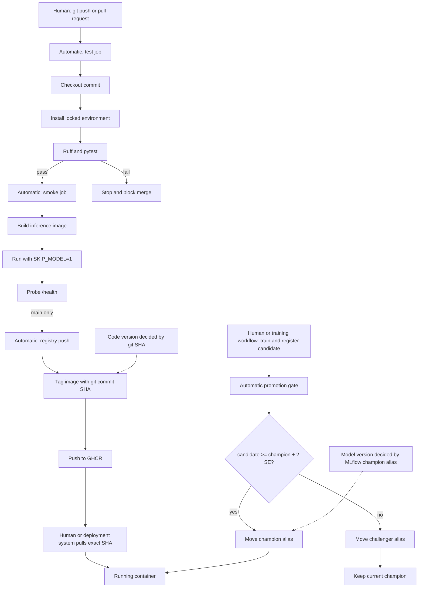

# Lab 5 - CI/CD with GitHub Actions

## Question 1

A unit test should not load the real MLflow model because that turns a small code test into an integration test with external state. Correct code could fail because the MLflow server is stopped or unreachable, because the `champion` alias or artifact is missing, because credentials or networking differ on CI, or because downloading and loading the large model exceeds the runner's time or memory limits.

## Question 2

The fake-model test proves that the API accepts a multipart image, decodes and preprocesses it into the expected tensor shape, calls the model, chooses the largest output, and returns valid JSON containing the category `Bread` and a bounded confidence. It does not prove that the trained model is accurate, that its real artifact loads from MLflow, or that its predictions generalize to real food images.

## Question 3

The `cross-split duplicates` check caught the deliberate copy by comparing MD5 hashes. The actual local mini dataset already contained 43 cross-split duplicates, and the deliberate copy increased the count to 44; the copied file was removed afterward. A duplicate is especially dangerous because it silently leaks test information into training and makes evaluation accuracy look better than real generalization. A corrupted image normally causes an obvious failure that can be located and fixed instead of silently biasing the metric.

## Question 4

The full validator can run in a training workflow immediately after `dvc pull` and before training, because that runner has access to the data. It can also run in a DVC/DagsHub data-publication workflow before a dataset version is accepted or promoted. A self-hosted GitHub runner with access to the local DVC remote is another suitable location.

## Question 5

Because `smoke` declares `needs: test`, GitHub skips it when the test job fails. Without `needs`, both jobs can start in parallel, so CI could spend time building and probing an image even though its unit tests already fail.

## Question 6

The first GitHub Actions run completed successfully in `7m 22s`: `test` took `19s`, `smoke` took `1m 47s`, and `push` took `5m 9s`. A second run with no code changes completed in `3m 1s`: `test` took `20s`, `smoke` took `2m 10s`, and `push` took only `21s`. The second test log confirmed a `setup-uv` cache hit, although the whole test job was about the same length because the fresh runner still created its environment. The major improvement was the registry push, which reused the GitHub Actions Docker layer cache instead of rebuilding and exporting every layer.

## Question 7

A commit SHA is immutable: it identifies the exact source revision used to build the image. The `latest` tag is mutable. For example, machine A can pull `latest` before a new release and machine B can pull the same tag afterward, leaving the two machines on different code even though their deployment files both say `latest`.

## Question 8

The push job explicitly grants `contents: read` and `packages: write` because GitHub tokens should receive only the permissions needed to check out code and publish the image. A compromised step with broad write access could modify repository contents, releases, workflows, issues, packages, or other project state and could potentially create a persistent supply-chain compromise.

## Question 9

Once branch protection is enabled, the deliberately broken pull request should show the `test` check as failed, skip `smoke`, and block a normal merge until a fixed commit makes the required checks green. This gives the team one centrally enforced and reproducible gate instead of relying on every developer to remember to run the same tests correctly on their laptop. The Lab 5 workflow has been pushed and verified on `main`; the protected-branch pull-request exercise still requires enabling the rule in the repository settings.

## Question 10

Two existing distinct Lab 2 logged runs were registered as candidates so the gate could be tested without repeating hours of training. Version 4 had test accuracy `0.390511` and was assigned `challenger`. Version 5 had test accuracy `0.718978` and was also assigned `challenger`. The current champion, version 3, had accuracy `0.726277` on 1,096 evaluation images. Its two-standard-error margin was `0.026936`, about 2.69 accuracy points, so a candidate needed at least `0.753213` to become champion. The champion stayed at version 3, challenger points to version 5, and both candidate versions contain the decision and metric tags.

## Question 11

One option is a self-hosted GitHub Actions runner on a machine that can reach the local MLflow server. Another is moving MLflow to a reachable hosted service, such as DagsHub's repository MLflow server, and giving the workflow its URI and credentials through GitHub secrets. The gate could then run automatically after the training job registers a candidate.

## Question 12

The code image version is fixed automatically by the Git commit SHA. The model version is selected independently by the MLflow `champion` alias after the quality gate. Creating a push or pull request, approving a protected-branch merge, and deploying the published image are still human-controlled unless a later deployment workflow automates them.
